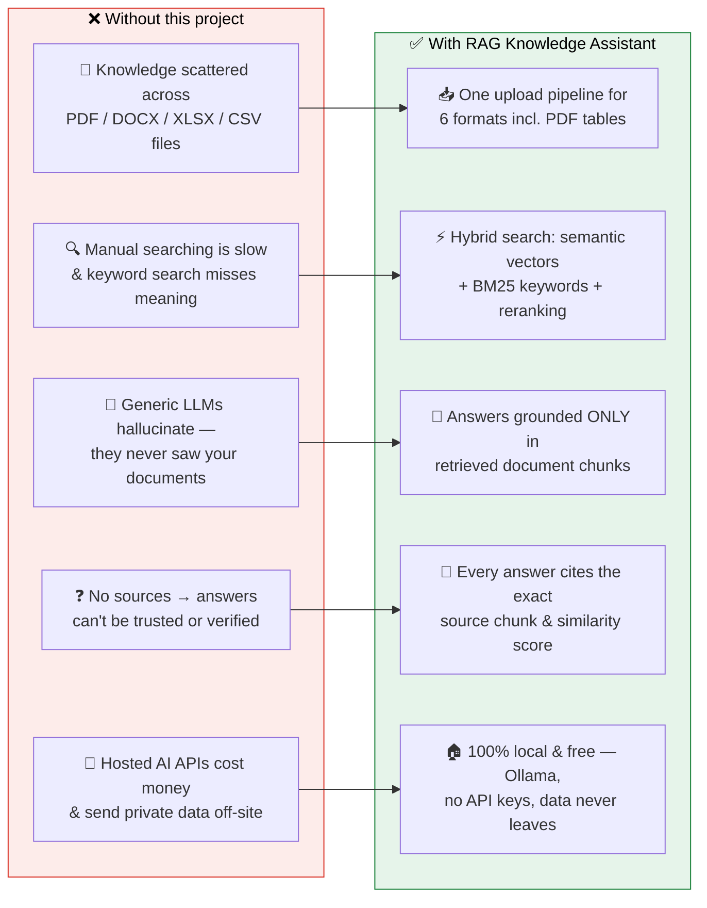
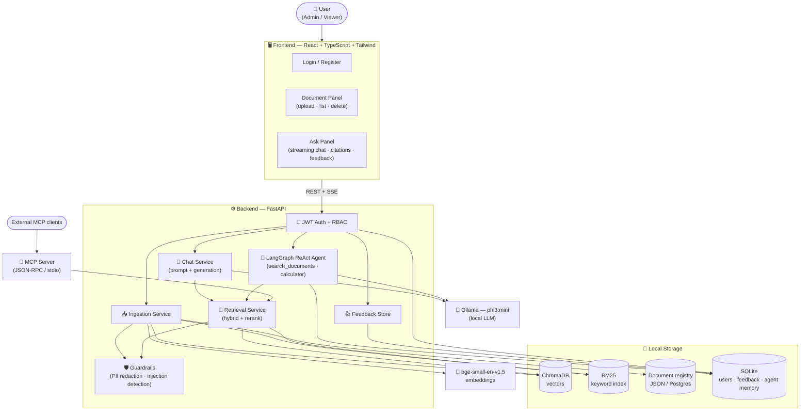
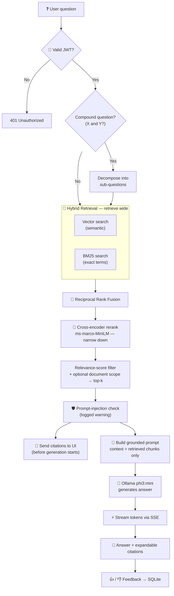
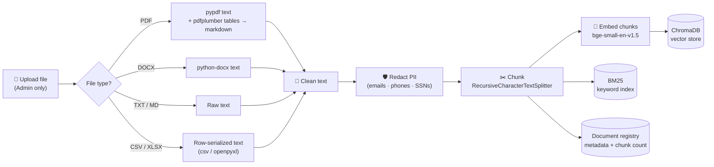
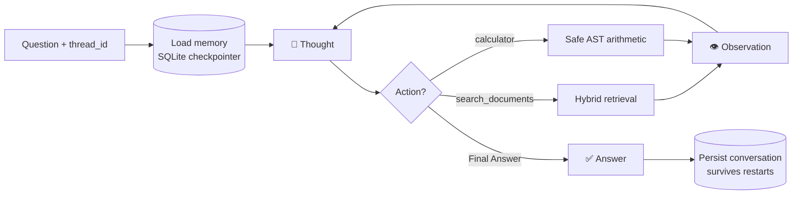

# Enterprise Knowledge Assistant (RAG)

Ask questions about your company documents and get answers **grounded in those documents, with citations** — running 100% locally and free (no API keys).

📹 See [`working demo.mp4`](working%20demo.mp4) for a walkthrough.

## The Problem It Solves

Generic LLMs have never seen your documents, so they **hallucinate** unverifiable answers — and hosted AI APIs cost money and send private data off-site. This project retrieves the relevant passages from *your* files first, then answers only from them, citing the exact source.



## How It Works



**Query flow** — retrieve wide, rerank narrow, answer only from retrieved chunks:



<details>
<summary><b>Ingestion flow (upload → searchable knowledge)</b></summary>



</details>

<details>
<summary><b>Agent flow (multi-step reasoning with memory)</b></summary>



</details>

## Key Features

- 📥 **6 formats** — PDF (incl. tables), DOCX, TXT, MD, CSV, XLSX
- 🔎 **Hybrid retrieval** — vector + BM25 keyword search, RRF fusion, cross-encoder reranking
- 📌 **Cited, streamed answers** — token-by-token via SSE, each answer linked to its source chunk
- 🧠 **LangGraph agent** with tools and SQLite-persisted memory
- 🔐 **JWT auth + RBAC** (admin / viewer)
- 🛡️ **Guardrails** — PII redaction at ingest, prompt-injection detection
- 📊 **LLM-as-judge eval**, feedback loop, MCP tool server, CI + Pytest suite

## Quick Start

**Prerequisite:** [Ollama](https://ollama.com) running with the model pulled — `ollama pull phi3:mini && ollama serve`

```bash
# Option A — Docker (backend + frontend)
docker compose up --build          # UI: http://localhost:5173 · API: http://localhost:8000

# Option B — run locally (Python 3.11+, Node 18+)
cd backend && pip install -r requirements.txt && uvicorn app.main:app --reload --port 8000
cd frontend && npm install && npm run dev
```

The first account you register becomes **admin** (can upload/delete documents); later accounts are **viewers**. Set a real `EKA_JWT_SECRET_KEY` before deploying anywhere shared.

## Tech Stack

| Layer | Choice |
|---|---|
| LLM | Ollama `phi3:mini` (swappable via `LLMProvider`) |
| Embeddings / Reranker | `bge-small-en-v1.5` / `ms-marco-MiniLM-L-6-v2` |
| Search | ChromaDB (vectors) + BM25Plus (keywords), fused with RRF |
| Storage | JSON or Postgres (metadata), SQLite (users, feedback, agent memory) |
| Backend / Frontend | FastAPI + Pydantic / React + TypeScript + Tailwind (Vite) |
| Agent | Hand-built LangGraph ReAct loop |
| Ops | Docker, GitHub Actions CI, Pytest |

## Future Work

```mermaid
flowchart LR
    NOW(["📍 Today<br/>Local, free, single-instance RAG"])

    subgraph Q1["🔜 Near term"]
        direction TB
        F1["🖼️ OCR for scanned PDFs & images<br/>(Tesseract / vision model)"]
        F2["📊 Context precision & recall<br/>metrics with multi-chunk golden set"]
        F3["🗄️ Alembic DB migrations"]
        F4["👑 Admin UI for user role management"]
    end

    subgraph Q2["🚀 Mid term"]
        direction TB
        F5["🧠 Larger / hosted LLMs via LLMProvider<br/>(better multi-hop agent reasoning)"]
        F6["🔭 LangSmith / OpenTelemetry tracing<br/>+ token & cost tracking"]
        F7["🛡️ NER-based PII detection &<br/>blocking injection guardrails"]
        F8["🌐 Sandboxed web-search &<br/>code-execution agent tools"]
    end

    subgraph Q3["🏢 Long term"]
        direction TB
        F9["📈 Multi-instance scaling<br/>(Postgres + pgvector, shared stores)"]
        F10["💾 Persistent storage for hosted demo"]
        F11["🔄 Connectors: Drive / SharePoint /<br/>Confluence auto-sync"]
        F12["🔁 Use feedback data to tune<br/>retrieval & prompts"]
    end

    NOW --> Q1 --> Q2 --> Q3
```



---

## More Details

<details>
<summary><b>Project structure</b></summary>

```
frontend/  React + TypeScript + Tailwind
  src/
    api.ts               typed API client (incl. SSE streaming, auth header injection)
    auth.tsx              auth context/hook (login, register, logout, token persistence)
    components/           LoginForm, DocumentPanel, AskPanel (incl. feedback buttons)

backend/
  app/
    api/routes/           HTTP layer (auth, documents, query, agent, feedback)
    api/security.py        get_current_user / require_role auth dependencies
    api/deps.py            dependency injection — swap providers here
    agent/                 hand-built LangGraph ReAct agent + tools (SQLite-persisted memory)
    services/              business logic:
      ingestion_service.py   extract -> clean -> redact PII -> chunk -> embed -> store
      retrieval_service.py   hybrid search: vector + BM25 -> RRF fusion -> rerank -> filter
      reranker_service.py    cross-encoder reranking
      chat_service.py        retrieval -> prompt -> generation, + query decomposition
      auth_service.py        register/login/JWT issuance (first user = admin)
      user_store.py          SQLite-backed user accounts
      feedback_store.py      SQLite-backed answer feedback (thumbs up/down)
      guardrails.py           PII redaction (ingest-time) + prompt-injection detection
    llm/                   LLM provider interface + Ollama adapter (streaming + non-streaming)
    vectorstore/           ChromaDB adapter + BM25 keyword index
    core/                   config + logging
    models/                 Pydantic request/response schemas
  eval/                    LLM-as-judge evaluation harness (faithfulness + answer relevancy)
  mcp_server/              hand-built MCP server (JSON-RPC over stdio)
  tests/                   Pytest tests (unit + integration + subprocess)

data/
  uploads/                 saved source files (gitignored)
  chroma/                  persisted vector index (gitignored)
  bm25_index.pkl           persisted BM25 keyword index (gitignored)
  documents.json           document metadata registry (JSON, or Postgres — see below)
  users.db                 SQLite user accounts
  feedback.db              SQLite answer feedback log
  agent_checkpoints.db     SQLite agent conversation memory (survives restarts)

.github/workflows/ci.yml  backend pytest + frontend build, on push/PR
```

Every module has a docstring explaining *why* it exists and *why* it was built
that way — treat them as the design-decision log, not just comments.

**Why layered like this:** routes never talk to Chroma, Ollama, or the
database directly — they go through `services`, which go through small
adapter interfaces (`LLMProvider`, `ChromaStore`, `DocumentRegistryBase`).
Swapping Ollama for OpenAI, Chroma for FAISS/pgvector, or JSON for Postgres
means changing `app/api/deps.py` and adding one new adapter file — not
touching routes, business logic, or tests.

</details>

<details>
<summary><b>Full stack — design rationale</b></summary>

| Layer | Choice | Why |
|---|---|---|
| LLM | Ollama, `phi3:mini` | Free, offline, no API key. Swappable via `LLMProvider`. |
| Embeddings | `BAAI/bge-small-en-v1.5` (sentence-transformers) | Free, CPU-friendly, strong MTEB retrieval scores for its size. |
| Vector store | ChromaDB (persistent, local) | Zero-ops embedded vector DB, no separate service to run. |
| Keyword search | `rank_bm25` (BM25Plus) | Catches exact-term matches (IDs, names) vector search misses; BM25Plus specifically avoids classic BM25's negative-IDF failure mode on small corpora. |
| Retrieval fusion | Reciprocal Rank Fusion | Combines vector + BM25 rankings without needing their scores on the same scale. |
| Reranking | `cross-encoder/ms-marco-MiniLM-L-6-v2` | "Retrieve wide, rerank narrow" — a cross-encoder scores query+chunk jointly for better precision than bi-encoder search alone. |
| Metadata store | JSON (default) or Postgres | JSON needs zero setup; Postgres (`EKA_DATABASE_URL`) adds real concurrent-write safety once you need it. |
| Auth / users / feedback / agent memory | SQLite (SQLAlchemy) | Zero-setup, file-based, matches the free/local philosophy — no service to run. |
| Chunking | LangChain `RecursiveCharacterTextSplitter` | Splits on paragraph/sentence boundaries first, avoids mid-sentence cuts. |
| Multimodal ingestion | `openpyxl` (XLSX), stdlib `csv`, `pdfplumber` (PDF tables) | Pure-Python, no OCR/system binaries — structured data survives as row-serialized or markdown-table text. |
| Guardrails | Hand-rolled regex (not a framework) | PII redaction at ingest time; prompt-injection *detection* (logged, not blocking) on retrieved content — same dependency-light philosophy as the MCP server and eval harness. |
| Agent | Hand-built LangGraph ReAct loop, SQLite checkpointer | `phi3:mini` isn't reliable at native tool-calling; plain-text Thought/Action/Observation works with any instruction-following model. SQLite persistence means conversations survive a backend restart. |
| Eval | Hand-built LLM-as-judge (not Ragas) | Same technique Ragas uses internally, zero extra dependency surface. |
| MCP | Hand-built JSON-RPC/stdio server (not the `mcp` SDK) | The SDK's HTTP transport deps conflicted with our pinned FastAPI/Starlette. |
| Observability | Hand-rolled request-ID + structured log line middleware (not OpenTelemetry) | One `uuid4` + one log line covers correlating a response to its request without a new dependency or external collector. |
| Backend | FastAPI + Pydantic | Async, auto-validated request/response schemas, auto OpenAPI docs. |
| Frontend | React + TypeScript + Tailwind (Vite) | Fast dev loop, typed API contract via `src/api.ts`. |
| Testing | Pytest | Unit tests via mocked/fake collaborators, FastAPI integration tests via `TestClient`, MCP tests via a real subprocess, agent-persistence tests via a real SQLite file. |
| CI | GitHub Actions | Backend `pytest` + frontend `npm run build` on every push/PR. |
| Deployment | Docker + docker-compose | Backend + frontend containerized; Ollama stays on the host for GPU access. |

</details>

<details>
<summary><b>Using the app (step by step)</b></summary>

1. **Register / sign in.** The very first account ever registered becomes
   **admin**; every account after that is a **viewer**. Admins can upload
   and delete documents and review the feedback log; viewers can query,
   use the agent, and browse existing documents.
2. **Upload** a document (PDF, DOCX, TXT, MD, CSV, or XLSX) — admin only.
   Wait for embedding to finish — the chunk count appears once it's
   searchable. Tables inside PDFs are extracted separately and appended
   as markdown; PII (emails, phone numbers, SSNs) is redacted before
   anything is embedded or stored.
3. **Ask** a question in the chat panel — retrieval fuses vector and
   keyword search results and reranks them before the answer streams in
   token-by-token, with citations appearing as soon as retrieval
   completes (before generation even starts). Compound questions
   ("X and Y?") are automatically decomposed into sub-questions first.
   Optionally select a specific document to scope retrieval to just that
   file.
4. **Rate an answer** — "Helpful" / "Not helpful" buttons appear once an
   answer finishes streaming; one rating per answer, logged for later
   review (admin-only `GET /feedback`).
5. **Expand a citation** to see the exact source chunk, filename, chunk
   index, and similarity score the model was shown.
6. Conversation history persists across page refreshes (via
   `localStorage`) — use "Clear conversation" to reset it. The **agent's**
   memory (`/agent/ask`, keyed by `thread_id`) is separately persisted
   server-side in SQLite and survives a backend restart.
7. **Delete** any document from the sidebar — admin only, irreversible,
   guarded by a confirmation dialog.

</details>

<details>
<summary><b>Deploying a live demo (Hugging Face Spaces)</b></summary>

The root `Dockerfile` (distinct from `backend/Dockerfile` and
`frontend/Dockerfile`, which are for the two-container `docker compose`
setup above) builds a **single** container — frontend + backend + Ollama
together — for platforms like Hugging Face Spaces that run one container
on one port. `app/main.py` serves the built frontend directly and mounts
every API route under `/api` in addition to its normal path, so there's no
nginx/proxy layer needed inside the container.

One-time setup:
1. Create a Hugging Face account at [huggingface.co](https://huggingface.co)
   if you don't have one.
2. Create a new Space at huggingface.co/new-space, selecting **Docker** as
   the SDK (any name/visibility). It'll build from an empty repo initially
   — that's fine, the GitHub Action below pushes real content to it.
3. Generate an access token with **write** scope: Settings → Access Tokens
   → Create new token.
4. In this GitHub repo: Settings → Secrets and variables → Actions → Secrets
   tab → New repository secret, named `HF_TOKEN`, value = that token.
5. Same page, Variables tab → New repository variable, named
   `HF_SPACE_CONFIGURED`, value = `true`. (Gates the deploy workflow so it
   skips cleanly instead of failing on every push before you've done steps
   1-4.)
6. Edit `.github/workflows/deploy-hf-space.yml` and replace
   `<HF_USERNAME>/<SPACE_NAME>` with your actual Space's path.

After that, every push to `main` triggers `.github/workflows/deploy-hf-space.yml`,
which mirrors the repo to the Space; Hugging Face builds the root
`Dockerfile` and the app goes live at
`https://huggingface.co/spaces/<HF_USERNAME>/<SPACE_NAME>`.

**Known limitation:** free HF Spaces have ephemeral disk storage —
uploaded documents, the Chroma/BM25 index, and the SQLite-backed stores
(users, feedback, agent memory) reset on every redeploy. Persistent
storage is a paid HF add-on, out of scope for a zero-cost demo. Register
a fresh account and re-upload a demo document after each deploy.

To test the single-container image locally before ever touching HF:
```bash
docker build -t eka-demo .
docker run -p 7860:7860 eka-demo
```
App: http://localhost:7860

</details>

<details>
<summary><b>Tests, evaluation & MCP server</b></summary>

#### Tests
```bash
cd backend
pytest -q
```
Unit tests (mocked/fake collaborators), FastAPI integration tests
(`TestClient` + `dependency_overrides`), MCP tests (real subprocess
speaking JSON-RPC over stdio), and agent-persistence tests (real SQLite
file, simulating a restart by rebuilding the graph against the same file).
Postgres-specific tests skip automatically unless `EKA_TEST_DATABASE_URL`
points at a reachable database. Runs automatically on push/PR via
`.github/workflows/ci.yml`.

#### Evaluation
```bash
cd backend
python -m eval.run_eval
```
Ingests a fixture document through the real pipeline, asks a golden set of
8 questions through the real `ChatService`, scores faithfulness and answer
relevancy with an LLM judge, prints a report, writes `eval/results.json`.

#### MCP server
```bash
cd backend
python -m mcp_server.server
```
Speaks JSON-RPC 2.0 over stdio (`initialize`, `tools/list`, `tools/call`)
— point any MCP-compatible client at this command to expose document
search as a tool outside this app entirely.

</details>

<details>
<summary><b>What's deliberately not built, and why</b></summary>

- **OCR for scanned PDFs/images** — would need a system-level binary
  (Tesseract) or a heavier vision model, breaking the zero-friction local
  setup. Table extraction and CSV/XLSX ingestion (pure-Python, no system
  deps) cover the multimodal ground that doesn't need OCR.
- **Python code-execution agent tool** — giving an LLM agent arbitrary code
  execution is a real security risk (prompt injection → RCE) without heavy
  sandboxing, disproportionate to this project's scope. The calculator
  tool covers safe arithmetic via a restricted AST evaluator instead.
- **Web search agent tool** — would require an external, typically paid,
  rate-limited API, conflicting with the zero-cost constraint.
- **A real DB migration tool (Alembic)** — the Postgres document registry
  and every SQLite-backed store create their schema inline
  (`Base.metadata.create_all`) rather than via migrations. Fine for a
  single table per store with no schema history to manage yet; worth
  revisiting the moment any of them needs its first `ALTER`.
- **LangSmith tracing, token/cost tracking** — `latency_ms` is tracked
  throughout, and the request-ID middleware gives basic correlation, but
  there's no LLM provider metering here since Ollama is free/local; full
  tracing is a natural next step if this moves to a hosted LLM.
- **Context precision/recall metrics** in the eval harness — meaningful
  measurement needs a multi-chunk golden document; the current fixture is
  short enough to fit in one chunk, so only faithfulness and answer
  relevancy (generation-quality metrics) are measured.

</details>

<details>
<summary><b>Known limitations</b></summary>

- `phi3:mini` (3.8B, CPU) is the latency bottleneck — expect 3-60s per
  answer depending on whether the model is already warm, and it struggles
  with true multi-hop agent reasoning (e.g., "look up X, then compute Y
  from it" across two different tools in one trajectory) — observed and
  documented in `app/agent/graph.py`.
- The relevance-score filter on retrieval (`min_relevance_score`) only
  gates hits that carry a vector cosine score — a chunk found only via
  BM25 keyword search has no comparable score and is kept by default
  (BM25Index already drops true zero-overlap matches itself). See
  `retrieval_service.py`'s docstring for the full reasoning.
- Guardrails are coarse regex heuristics, not a real PII/NER model or a
  guardrails framework — they catch common patterns (emails, US-format
  phone numbers/SSNs, a handful of injection phrasings) and nothing more.
  Prompt-injection detection only *logs a warning*; it doesn't block
  anything. Don't rely on either for documents actually containing
  sensitive data — redact before uploading if that matters.
- The JSON document registry uses a process-local lock — safe for one
  backend instance, not for multiple instances behind a load balancer.
  The Postgres migration (`EKA_DATABASE_URL`) exists for exactly that
  case; a real multi-instance deployment would need it turned on. The
  SQLite-backed stores (users, feedback, agent memory) share the same
  single-process assumption.
- There's no self-service way to become admin beyond being the first
  account ever registered — promoting a later account is a direct
  database edit, not an API surface (deliberately: it shouldn't be
  reachable by a compromised viewer token).

</details>
